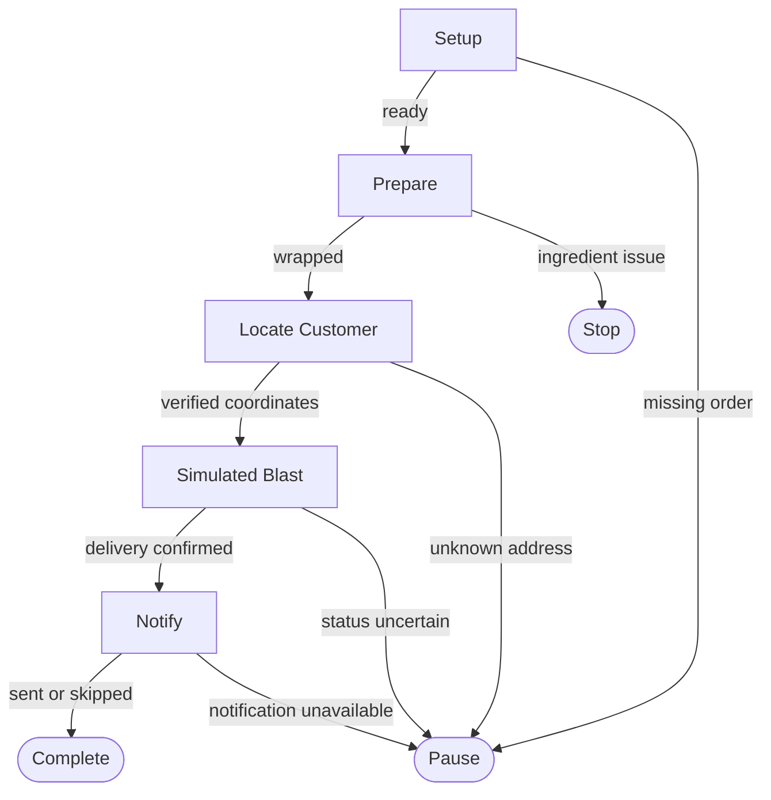

# Burrito Cannon Blaster 🌯

A completely fictional demonstration that prepares a burrito, resolves customer data, simulates a cannon delivery, and simulates a notification. It never launches a projectile, queries a real customer service, or sends a real SMS.

## Flowchart

## Guidance and boundaries

Node instructions are in `nodes/*.md`, never synthesized from the diagram. All customer records and delivery receipts in this example are fictional. Tool hints are capability suggestions, not permissions.

## Success criteria

A fictional burrito was prepared, a destination was verified within simulated data, the simulated delivery was confirmed, and notification outcome was recorded.

## Handover

Return the burrito reference, verified coordinates, `isMember` boolean, delivery result, notification result and evidence. If delivery remains uncertain, preserve a partial/blocked handover and explain why.
