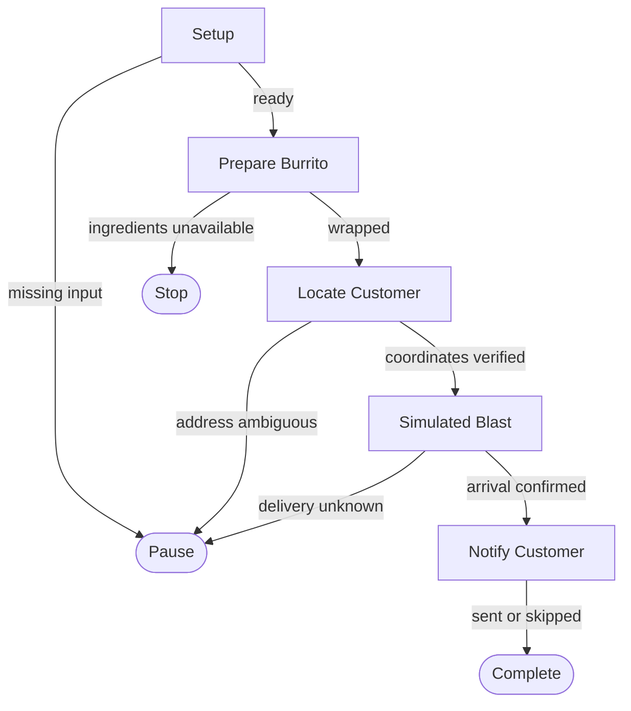

# Burrito Cannon Blaster

This map makes a fictional burrito order, locates the customer, simulates delivery through a fantastical cannon, and records an SMS notification outcome. It is intentionally silly; no physical launches or real SMS messages are performed.

## Flowchart

## Why This Map Exists

Give an agent a predictable path through an amusing delivery job, while allowing it to look up available capabilities rather than insisting on particular tool names.

## Boundaries

- This is a *simulation only*. No real projectile launcher may be operated.
- Customer locations, consent and delivery confirmations must not be invented.
- No SMS should be sent without appropriate consent and authorization.
- The interactive HTML companion is for people, not for executing the graph.

## Successful Handover

Return a structured result containing burrito details, verified coordinates, membership status, simulated delivery confirmation, SMS notification status, and evidence references.
