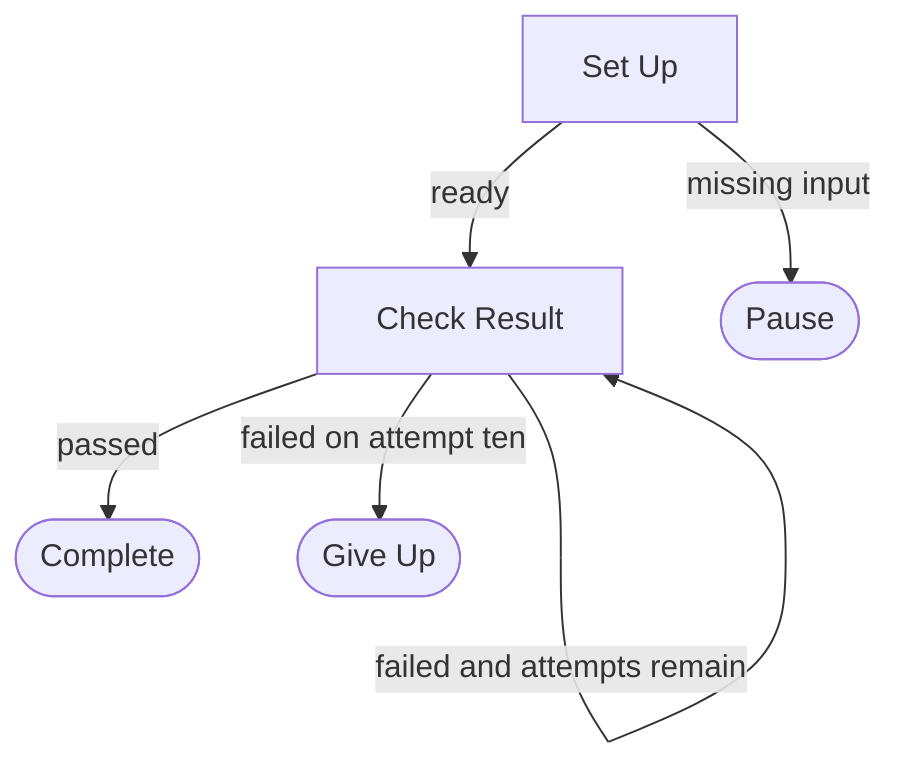

# Retry a check, then give up

A small fictional workflow showing success, retry, and giving up after ten attempts. Nothing is executed by this page.

## Flowchart

## Try the viewer

- Click Check Result on the graph to inspect its instructions. This does not move the preview position.
- In Route explorer, select ready to move the preview from Set Up to Check Result.
- Select failed and attempts remain to follow the loop, then passed or failed on attempt ten to explore an exit.
- Reset route returns the preview to Set Up.

## Important distinction

The route explorer is a manual illustration, not a runner. It does not count attempts or enforce max_visits. During actual execution, the agent uses the saved Trail to enforce the ten-attempt limit.

## Boundaries and result

Use fictional local results only. No external services, messages, or deployments. Preserve available results and report either a successful check or the reason for giving up.
