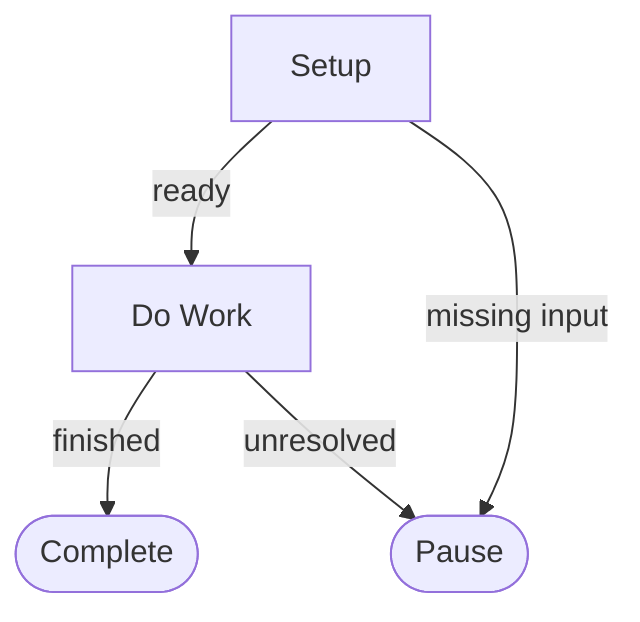

# REPLACE_TITLE

TODO: Explain what this map accomplishes and for whom.

## Flowchart

## Guidance

Read each real node file before executing that node. The Mermaid flowchart determines the allowed routes; node filenames are IDs.

## Boundaries

TODO: Describe appropriate user authorization, risky operations, and explicit exclusions.

## Success

TODO: Define what evidence confirms a useful result.

## Handover

Deliver an evidence-backed result in `handover.yaml` for the user or an independently authorized next map. Do not automatically chain another map.
