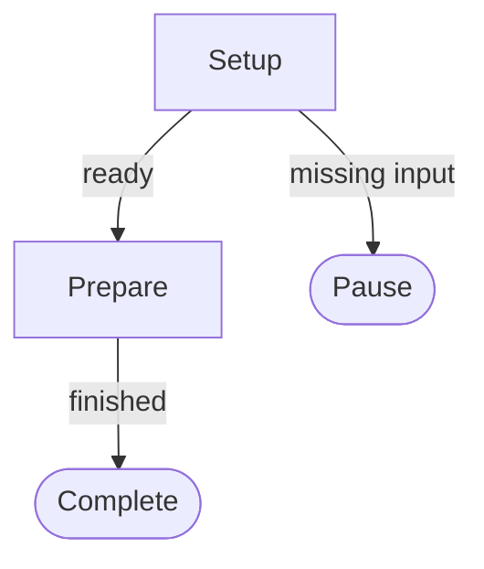

# DriftMaps — authoring contract

## Two files, two roles

- `MAP.md`: the complete job, boundaries, and one authoritative Mermaid graph. YAML frontmatter contains only discoverable machine guidance. Markdown prose has no fixed heading requirements **except `## Flowchart`**, which locates the graph.
- `nodes/<node>.md`: one executable operation. YAML header describes small shared inputs/outputs and optional tool hints or visit budget. The body may contain narrative, examples, commands, checklists or diagrams. Never reconstruct an absent node.
- No additional alias, ID, step order or `next` contract. The node ID is its filename stem and the Mermaid reference.

## Map frontmatter

```yaml
---
name: burrito-cannon
version: "0.1.0"
status: draft
limits:
  max_transitions: 20
---
```

For the portable v1 subset, accept simple YAML keys and the above nested limit; `name` matches directory slug, `version` is numeric semver, and `status` is `draft`, `active`, or `example`. `max_transitions` must be a finite positive integer.

## Map graph



- Start at `setup`. It is a root and `nodes/setup.md` must exist.
- Each executable node ID maps **exactly** to `nodes/<id>.md` with lowercase kebab-case IDs.
- `pause`, `stop`, and `complete` are reserved terminal/control destinations without files.
- Each line has one `-->` transition (possibly with `|outcome label|`). Use descriptive labels for multiple outcomes.
- Explicit edges define the complete set of allowed next destinations. A chart is not permission to perform external actions.
- Cycles are permitted; the map-wide budget is always finite. Use `max_visits` and explicit pause/stop options for expensive re-investigations.
- The included validator supports basic Mermaid node labels, simple edges, basic style lines, and one edge per line. Unsupported graph syntax must be corrected or inspected manually; never silently simplify it.

## Node header

```yaml
---
requires:
  - customer_ref
produces:
  - coordinates
  - isMember
tool_hints:
  - customer_lookup
max_visits: 2
---
```

`requires` and `produces` are always present (empty lists allowed). These name values in Trail `context` or named items in Trail `artifacts`. `tool_hints` is optional and **nonbinding**. A name like `github_write`, `jira_update`, or `teams_alert` suggests a useful capability, not a hard requirement, specific integration, or authority. The executing agent may find an equivalent authorized approach. `max_visits` is optional, counts every entry to that node across pauses/resumes, and must be positive if provided.

## Book-to-book output

A node returns data to the shared Trail and an observed edge outcome. The **whole map** returns one `handover.yaml` at terminal/paused exit. See [execution.md](execution.md) for the `meta/result/continuation` contract.

## Validation philosophy

Validate structural commitments: real files, entry, node names, edge targets, finite budget, YAML headers, and orphans. Do **not** over-police the Markdown writing style, force tools by name, infer permissions from hints, or require a separate human HTML page.
